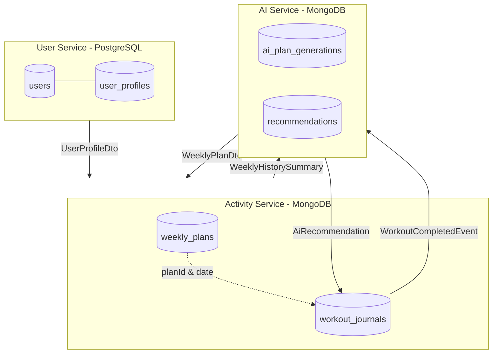
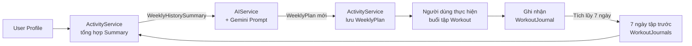

# Database Architecture & Data Models Specification

Tài liệu này chuẩn hóa toàn bộ cấu trúc Database (Thực thể, Thuộc tính, Quan hệ và DTO) của hệ thống **Zero Fitness**, bám sát kiến trúc 3 microservices cốt lõi và chu trình huấn luyện tuần hoàn thích ứng **Weekly Adaptive AI Coaching Cycle**.

---

## 1. Phân Chia Trách Nhiệm Dữ Liệu (Service Boundaries)



| Service               | Cơ sở dữ liệu               | Vai trò chính                                                                                                                                                                       |
| :----------------------| :----------------------------| :------------------------------------------------------------------------------------------------------------------------------------------------------------------------------------|
| **`userservice`**     | **PostgreSQL** (Relational) | Quản lý tài khoản, User Profile (thể chất, số đo, mục tiêu, kinh nghiệm, thể loại yêu thích, ràng buộc chấn thương, dụng cụ).                                                       |
| **`activityservice`** | **MongoDB** (Document)      | Quản lý Kế hoạch tuần (`WeeklyPlan`), Chi tiết buổi tập (`WorkoutDay`), Bài tập (`WorkoutExercise`), Nhật ký sau buổi tập (`WorkoutJournal`), và Lịch sử tập luyện.                 |
| **`aiservice`**       | **MongoDB** (Document)      | Nhận `UserProfile` + `WeeklyHistorySummary` ➔ Gọi Gemini AI ➔ Trả về `WeeklyPlan`. Lưu Audit log tạo plan (`AiPlanGeneration`) và các lời khuyên phục hồi nhỏ (`AiRecommendation`). |

---

## 2. Chu Trình Thích Ứng Cốt Lõi (Core Adaptive Loop)

Hệ thống không gửi nguyên toàn bộ lịch sử thô (raw logs) sang Gemini AI để tránh quá tải token và loãng context, mà thông qua **`WeeklyHistorySummary`**:



---

## 3. Chi Tiết Thực Thể (Database Entities)

### A. `userservice` (PostgreSQL)

#### 1. Bảng `users`
* `id` (`VARCHAR(36)` / UUID, PK): Khóa chính nội bộ.
* `keycloak_id` (`VARCHAR(255)`, Unique, Indexed): Định danh người dùng từ Keycloak IAM (OAuth2 `sub`).
* `email` (`VARCHAR(255)`, Unique, Not Null): Địa chỉ email.
* `firstname` (`VARCHAR(255)`): Tên.
* `lastname` (`VARCHAR(255)`): Họ.
* `role` (`VARCHAR(50)`): Role (`USER`, `ADMIN`).
* `created_at` (`TIMESTAMP`): Ngày tạo.

#### 2. Bảng `user_profiles`
* `id` (`VARCHAR(36)` / UUID, PK): Khóa chính.
* `user_id` (`VARCHAR(36)`, Unique, FK -> `users.id`): Liên kết 1-1 với user.
* `gender` (`VARCHAR(20)`): `MALE`, `FEMALE`, `OTHER`.
* `age` (`INTEGER`): Tuổi.
* `height` (`DOUBLE PRECISION`): Chiều cao (cm).
* `weight` (`DOUBLE PRECISION`): Cân nặng (kg).
* `chest` (`DOUBLE PRECISION`): Vòng 1 (cm).
* `waist` (`DOUBLE PRECISION`): Vòng 2 / eo (cm).
* `hips` (`DOUBLE PRECISION`): Vòng 3 / mông (cm).
* `activity_level` (`VARCHAR(50)`): `SEDENTARY`, `LIGHT`, `MODERATE`, `ACTIVE`, `VERY_ACTIVE`.
* `fitness_goal` (`VARCHAR(50)`): `FAT_LOSS`, `WEIGHT_LOSS`, `MUSCLE_GAIN`, `STRENGTH`, `ENDURANCE`, `FLEXIBILITY`, `GENERAL_FITNESS`.
* `experience` (`VARCHAR(50)`): `BEGINNER` (<6 tháng), `INTERMEDIATE` (6T–2N), `ADVANCED` (>2N).
* `custom_wishes` (`VARCHAR(1000)`): Nguyện vọng và lưu ý tự do cho AI Coach.
* `workout_duration` (`VARCHAR(50)`): Thời lượng ưu tiên (`15-20`, `30-45`, `45-60`).
* `is_profile_completed` (`BOOLEAN`): Trạng thái mở khóa Onboarding.
* `created_at` / `updated_at` (`TIMESTAMP`).

**Bảng phụ liên kết Collection (ElementCollection):**
* `user_selected_days` (`profile_id`, `day_number` INT): Các ngày tập trong tuần (`1`=T2 .. `7`=CN).
* `user_workout_preferences` (`profile_id`, `preference` VARCHAR): Thể loại ưu tiên (`STRENGTH`, `CARDIO`, `YOGA`, `PILATES`, `MOBILITY`, `HIIT`).
* `user_limitations` (`profile_id`, `limitation` VARCHAR): Ràng buộc chấn thương (`KNEE_PAIN`, `LOWER_BACK`, `WRIST_PAIN`, `NECK_SHOULDER`, `NO_JUMPING`, `STANDING_ONLY`).
* `user_equipment` (`profile_id`, `equipment` VARCHAR): Dụng cụ (`BODYWEIGHT`, `YOGA_MAT`, `RESISTANCE_BAND`, `DUMBBELL`, `CHAIR_WALL`, `KETTLEBELL`, `SWISS_BALL`).

---

### B. `activityservice` (MongoDB)

#### 1. Collection `weekly_plans`
Lưu trữ kế hoạch tập tuần do AI tạo ra và người dùng bấm áp dụng:

```json
{
  "_id": "ObjectId",
  "userId": "String (keycloakId)",
  "goal": "String (e.g. Giảm vòng eo & siết cơ)",
  "level": "String (Beginner | Intermediate | Advanced)",
  "durationPerSession": "String (30-45)",
  "frequencyPerWeek": 5,
  "weeklyOverview": "String (Tuần này: 5 buổi · ~190 phút · Core · Lower Body · Full Body)",
  "coachTip": "String (Gợi ý từ AI Coach về nhịp độ và bảo vệ khớp)",
  "startDate": "LocalDate (YYYY-MM-DD)",
  "endDate": "LocalDate (YYYY-MM-DD)",
  "isActive": true,
  "days": [
    {
      "dayIndex": 1,
      "dayName": "T2",
      "date": "LocalDate (YYYY-MM-DD)",
      "focus": "Core",
      "intensity": "Moderate",
      "totalMinutes": 42,
      "isRestDay": false,
      "exercises": [
        {
          "phase": "WARMUP",
          "name": "Khởi động kích hoạt khớp & cơ lõi",
          "durationMinutes": 5,
          "youtubeVideoId": "y87vQ6kG70k",
          "order": 1
        },
        {
          "phase": "MAIN",
          "name": "Bài tập siết eo & Plank biến thể",
          "durationMinutes": 25,
          "youtubeVideoId": "1f8yoFFdkLU",
          "order": 2
        },
        {
          "phase": "COOLDOWN",
          "name": "Giãn cơ & hạ nhịp tim",
          "durationMinutes": 12,
          "youtubeVideoId": "4vTj6pnd9v0",
          "order": 3
        }
      ]
    }
  ],
  "createdAt": "ISODate",
  "updatedAt": "ISODate"
}
```

> **Ghi chú về `status` của WorkoutDay**:
> Không cần lưu trường `status` tĩnh trong DB. Trạng thái ngày tập (`COMPLETED`, `TODAY`, `UPCOMING`, `REST`, `MISSED`) được tính toán động (dynamically derived) bằng cách đối chiếu `date` hiện tại với bảng `workout_journals`.

#### 2. Collection `workout_journals`
Lưu trữ nhật ký hoàn thành buổi tập khi người dùng submit qua modal post-workout:

```json
{
  "_id": "ObjectId",
  "userId": "String (keycloakId)",
  "planId": "String (ObjectId liên kết weekly_plans)",
  "dayIndex": 1,
  "workoutTitle": "Core & Abs Blast",
  "completedAt": "ISODate",
  "actualDurationMinutes": 42,
  "plannedDurationMinutes": 42,
  "plannedIntensity": "Moderate",
  "caloriesBurned": 210,
  
  "difficulty": 3,
  "energy": 4,
  "hasPain": false,
  "painLocations": [],
  "notes": "Hôm nay hoàn thành đủ 3 video, cảm thấy siết eo rất tốt, không bị đau lưng.",
  "photoUrl": "https://storage.zerofitness.com/checkins/...",
  "coachAdvice": "Hôm nay năng lượng của bạn rất tốt (4/5). Hãy uống đủ 500ml nước ấm sau khi giãn cơ.",
  
  "createdAt": "ISODate"
}
```

* `plannedDurationMinutes` & `plannedIntensity`: Bổ sung để AI dễ dàng so sánh kế hoạch dự kiến vs thực tế người dùng đã thực hiện.
* `caloriesBurned`: Là **chỉ số ước tính tương đối** dựa trên thời lượng và cường độ bài tập, **không xem là số đo y khoa hay dinh dưỡng chính xác** (phù hợp với định vị ứng dụng thuần workout).
* `energy`: Thang 1–5 (1-Kiệt sức -> 5-Bùng nổ) — trực tiếp điều khiển độ đậm nhạt của ô ngày trên trang Tiến độ.
* `photoUrl`: **Chỉ lưu đường dẫn URL / Object Storage reference** (AWS S3, MinIO, Cloudinary...), **tuyệt đối không lưu file ảnh nhị phân (Binary Blob / Base64) trực tiếp vào MongoDB** để đảm bảo hiệu năng và kiểm soát kích thước database.

---

### C. `aiservice` (MongoDB)

#### 1. Collection `ai_plan_generations` (Tách riêng khỏi recommendation)
Lưu trữ audit trail mỗi lần AI tạo kế hoạch tuần mới để phục vụ tracking & so sánh:

```json
{
  "_id": "ObjectId",
  "userId": "String (keycloakId)",
  "planId": "String (ObjectId tương ứng bên weekly_plans)",
  "generatedAt": "ISODate",
  "contextPeriod": {
    "from": "YYYY-MM-DD",
    "to": "YYYY-MM-DD"
  },
  "metricsAtGeneration": {
    "completionRate": 80.0,
    "actualMinutes": 168,
    "averageDifficulty": 3.2,
    "averageEnergy": 3.8,
    "painReports": ["KNEE_PAIN"],
    "focusDistribution": { "Core": 2, "Lower Body": 1, "Full Body": 1 }
  },
  "coachSummary": "Điều chỉnh tuần này giảm nhảy vì có báo cáo mỏi gối ở buổi tập trước",
  "adjustmentsMade": [
    "Replaced jumping jacks with standing low-impact cardio",
    "Increased warm-up duration for knees by 2 mins"
  ],
  "aiModel": "String (Ghi nhận model thực tế cấu hình tại runtime, ví dụ: ${gemini.model:gemini-1.5-flash} - không hard-code chuỗi tĩnh)",
  "promptVersion": "v2.1-workout-only"
}
```

#### 2. Collection `recommendations`
Lưu trữ lời khuyên tức thời sau buổi tập hoặc phân tích phục hồi đột xuất:

```json
{
  "_id": "ObjectId",
  "journalId": "String (ObjectId của workout_journal)",
  "userId": "String (keycloakId)",
  "activityType": "WORKOUT_SESSION",
  "recommendation": "Phát hiện bạn cảm thấy kiệt sức (Energy 1/5) và có đau lưng dưới. Khuyến nghị ngày mai chuyển sang giãn cơ sâu.",
  "improvements": ["Hạ tạ ở bài Deadlift", "Siết chặt cơ bụng để bảo vệ thắt lưng"],
  "suggestions": ["15 phút Foam Rolling lưng dưới"],
  "safety": ["Ngừng ngay nếu đau nhói"],
  "createdAt": "ISODate"
}
```

---

## 4. Đặc Tả DTO (Data Transfer Objects) Cốt Lõi

### DTO 1: `WeeklyHistorySummary` (ActivityService ➔ AIService)
```json
{
  "totalScheduledDays": 5,
  "completedDays": 4,
  "completionRate": 80.0,
  "actualMinutes": 168,
  "targetMinutes": 190,
  "averageDifficulty": 3.2,
  "averageEnergy": 3.8,
  "painReports": ["KNEE_PAIN"],
  "focusDistribution": {
    "Core": 2,
    "Lower Body": 1,
    "Upper Body": 1
  }
}
```

### DTO 2: `AiGeneratePlanRequest` (Gửi vào AIService)
```json
{
  "userProfile": {
    "gender": "FEMALE",
    "age": 24,
    "height": 162.0,
    "weight": 53.0,
    "waist": 65.0,
    "fitnessGoal": "FAT_LOSS",
    "experience": "BEGINNER",
    "workoutPreferences": ["CARDIO", "PILATES"],
    "selectedDays": [1, 2, 4, 5, 7],
    "workoutDuration": "30-45",
    "limitations": ["KNEE_PAIN", "NO_JUMPING"],
    "equipment": ["BODYWEIGHT", "YOGA_MAT"],
    "customWishes": "Mong muốn giảm 3cm vòng eo trước đám cưới tháng sau"
  },
  "previousWeekSummary": {
    "completionRate": 80.0,
    "actualMinutes": 168,
    "averageDifficulty": 3.2,
    "averageEnergy": 3.8,
    "painReports": ["KNEE_PAIN"],
    "focusDistribution": { "Core": 2, "Lower Body": 1 }
  },
  "targetWeek": {
    "startDate": "2026-10-05",
    "endDate": "2026-10-11"
  }
}
```

> **Lưu ý quan trọng về `previousWeekSummary`**:
> Đối với **tuần đầu tiên mới bắt đầu (sau Onboarding)** khi người dùng chưa có lịch sử tập luyện trước đó, trường `previousWeekSummary` **cho phép mang giá trị `null`**. Khi đó, AI Service sẽ tự động chuyển sang chế độ tạo lịch khởi động dựa thuần túy trên `userProfile` (mục tiêu, kinh nghiệm, ràng buộc chấn thương, dụng cụ và nguyện vọng riêng).

### DTO 3: `WorkoutJournalRequest` (Frontend ➔ ActivityService)
```json
{
  "planId": "651a2b...",
  "dayIndex": 1,
  "workoutTitle": "Core & Abs Blast",
  "actualDurationMinutes": 42,
  "plannedDurationMinutes": 42,
  "plannedIntensity": "Moderate",
  "caloriesBurned": 210,
  "difficulty": 3,
  "energy": 4,
  "hasPain": false,
  "painLocations": [],
  "notes": "Cảm giác siết cơ bụng rất rõ rệt.",
  "photoUrl": "..."
}
```

### DTO 4: `MonthlyProgressResponse` (ActivityService ➔ ProgressPage Frontend)
```json
{
  "year": 2026,
  "month": 10,
  "totalWorkouts": 14,
  "totalMinutes": 532,
  "averageEnergy": 3.9,
  "days": [
    {
      "day": 1,
      "date": "2026-10-01",
      "status": "COMPLETED",
      "workoutTitle": "Core & Abs Blast",
      "duration": 42,
      "energy": 4,
      "difficulty": 3,
      "hasPain": false,
      "painLocations": [],
      "notes": "...",
      "coachAdvice": "..."
    }
  ]
}
```
* Trường `energy` (1-5) ở đây giúp frontend `ProgressPage.jsx` render ô lịch với sắc độ xanh chính xác:
  * Level 1: `#F0FDF4`
  * Level 2: `#DCFCE7`
  * Level 3: `#A7F3D0`
  * Level 4: `#34D399`
  * Level 5: `linear-gradient(135deg, #10B981, #059669)`

---

## 5. Lộ Trình Triển Khai Code Tiếp Theo

1. **`activityservice`**:
   - Tạo document entities: `WeeklyPlan`, `WorkoutDay`, `WorkoutExercise`, `WorkoutJournal`.
   - Tạo các Mongo Repositories tương ứng.
   - Viết Service tính toán `WeeklyHistorySummary` từ các bản ghi `WorkoutJournal`.
   - Tạo DTOs (`WorkoutJournalRequest`, `WeeklyPlanDto`, `MonthlyProgressResponse`).
2. **`aiservice`**:
   - Tạo document entity: `AiPlanGeneration` (tách riêng khỏi `recommendations`).
   - Tạo API `POST /api/ai/plans/generate` nhận `AiGeneratePlanRequest` và gọi Gemini prompt trả về cấu trúc `WeeklyPlanDto`.
