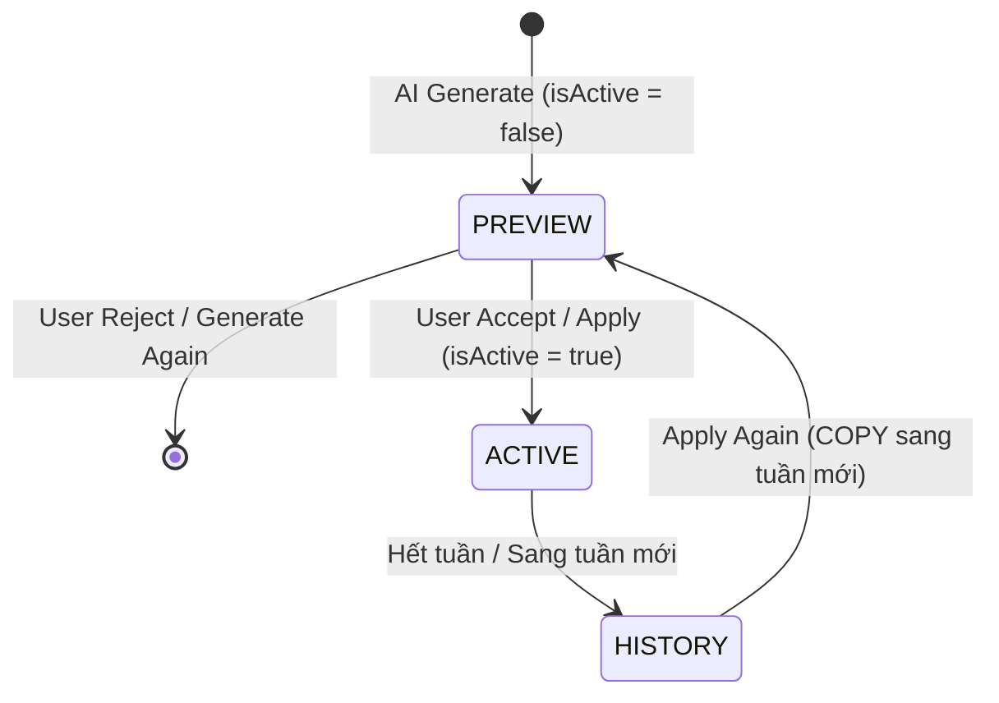

# Feature Spec 03: F02 — WeeklyPlan Domain

## 1. Mục Tiêu (Goal)

Xây dựng Domain và API quản lý **Kế hoạch tập luyện theo tuần (`WeeklyPlan`)** tại `activityservice`, đáp ứng chu trình huấn luyện tuần hoàn thích ứng (Weekly Adaptive AI Coaching Cycle), tách biệt hoàn toàn giữa việc **Tạo Plan Preview** và **User Chấp Nhận Kích Hoạt (Apply/Accept)**.

---

## 2. Bốn Nguyên Tắc Cốt Lõi (Core Principles)

1. **Create ≠ Apply**: AI hoặc backend tạo kế hoạch chỉ ở trạng thái xem trước (**PREVIEW**, `isActive = false`). Người dùng bắt buộc phải bấm chấp nhận ("Áp Dụng Lịch Tập Này & Bắt Đầu") thì kế hoạch mới chuyển sang **ACTIVE**.
2. **Active Plan Bất Biến (Immutable)**: Kế hoạch khi đã kích hoạt sẽ không được chỉnh sửa nội dung bài tập để bảo toàn tính toàn vẹn cho việc đo lường, phân tích và so sánh hiệu quả.
3. **Tái Sử Dụng Bằng Bản Sao (Copy on Reuse)**: Khi người dùng muốn tập lại lịch của một tuần cũ yêu thích, hệ thống **không tái kích hoạt plan cũ** mà thực hiện **COPY** thành một WeeklyPlan mới với mốc thời gian của tuần hiện tại. Kế hoạch cũ được giữ nguyên cho Audit & Lịch sử AI.
4. **Cố Định 7 Ngày & Bắt Đầu Động (Dynamic Onboarding Boundary)**: Mọi kế hoạch tuần luôn chứa đủ 7 ngày (T2 ➔ CN). Nếu người dùng bắt đầu vào giữa tuần (ví dụ Thứ 4), các ngày trước đó (T2, T3) không bị tính là `MISSED` và tỉ lệ hoàn thành (`completionRate`) chỉ bắt đầu tính từ ngày kích hoạt (`trainingStartDate`).

---

## 3. Vòng Đời Kế Hoạch (Plan Lifecycle)



* **PREVIEW**: Kế hoạch vừa được AI sinh ra hoặc tạo nháp. `isActive = false`. Người dùng đang xem xét trên giao diện `AiPlanPage`.
* **ACTIVE**: Kế hoạch đang thực thi duy nhất của người dùng trong tuần. Chỉ có tối đa **1 Active Plan** cho một user tại một thời điểm.
* **HISTORY**: Kế hoạch của các tuần trước. Dùng làm dữ liệu lịch sử cho AI phân tích tiến độ tuần tiếp theo.

---

## 4. Xử Lý Khi Bắt Đầu Giữa Tuần (Mid-Week Onboarding)

* **Quy tắc**: Kế hoạch luôn bao quát trọn vẹn tuần từ Thứ Hai (`startDate`) đến Chủ Nhật (`endDate`).
* **Ví dụ thực tế**:
  * Người dùng đăng ký và hoàn thành Onboarding vào **Thứ Tư ngày 07/10**.
  * Tuần tập hiện tại: **05/10 (T2) ➔ 11/10 (CN)**.
  
  ```text
  Tuần: 05/10 (T2) ───────────────────────────────> 11/10 (CN)
         T2          T3          T4          T5          T6          T7          CN
         ─           ─           ✓           ✓           ✓           ✓           ✓
                                 ↑
                        trainingStartDate
  ```

* **Trạng thái ngày (Dynamic Status)**:
  * Ngày trước `trainingStartDate` (T2, T3): Đánh dấu trạng thái không khả dụng / chưa bắt đầu, **hoàn toàn không tính là `MISSED`**.
  * Ngày từ `trainingStartDate` trở đi: Được tính bình thường (`TODAY`, `UPCOMING`, `COMPLETED`, `REST`).
  * `trainingStartDate` được lấy từ ngày kích hoạt plan (`activatedAt`) hoặc ngày hoàn thành Onboarding của profile.

---

## 5. Cấu Trúc Dữ Liệu & Thực Thể (Domain Models)

### Collection: `weekly_plans` (MongoDB)

```json
{
  "_id": "ObjectId",
  "userId": "String (Keycloak ID)",
  "goal": "String (VD: Giảm vòng eo & siết cơ)",
  "level": "String (Beginner | Intermediate | Advanced)",
  "durationPerSession": "String (30-45)",
  "frequencyPerWeek": 5,
  "weeklyOverview": "String (Tuần này: 5 buổi · ~190 phút · Core · Lower Body · Full Body)",
  "coachTip": "String (Gợi ý phục hồi từ AI Coach)",
  
  "startDate": "LocalDate (YYYY-MM-DD - Thứ 2 đầu tuần)",
  "endDate": "LocalDate (YYYY-MM-DD - Chủ nhật cuối tuần)",
  "trainingStartDate": "LocalDate (Ngày người dùng bắt đầu tập thực tế)",
  "isActive": false,
  "activatedAt": "ISODate (Thời điểm user bấm Apply, null nếu PREVIEW)",
  
  "days": [
    {
      "dayIndex": 1,
      "dayName": "T2",
      "date": "LocalDate (YYYY-MM-DD)",
      "focus": "Core",
      "intensity": "Moderate",
      "totalMinutes": 42,
      "isRestDay": false,
      "exercises": [
        {
          "phase": "WARMUP",
          "name": "Khởi động kích hoạt khớp & cơ lõi",
          "durationMinutes": 5,
          "youtubeVideoId": "y87vQ6kG70k",
          "order": 1
        },
        {
          "phase": "MAIN",
          "name": "Bài tập siết eo & Plank biến thể",
          "durationMinutes": 25,
          "youtubeVideoId": "1f8yoFFdkLU",
          "order": 2
        },
        {
          "phase": "COOLDOWN",
          "name": "Giãn cơ & hạ nhịp tim",
          "durationMinutes": 12,
          "youtubeVideoId": "4vTj6pnd9v0",
          "order": 3
        }
      ]
    }
  ],
  "createdAt": "ISODate",
  "updatedAt": "ISODate"
}
```

> **Quy tắc quan trọng về `status` của WorkoutDay**:
> **TUYỆT ĐỐI KHÔNG LƯU `status` tĩnh trong database**. Trạng thái hiển thị trên giao diện (`COMPLETED`, `TODAY`, `UPCOMING`, `REST`, `MISSED`) được tính toán động (dynamically derived) dựa trên:
> 1. Ngày của buổi tập (`WorkoutDay.date`)
> 2. Ngày hiện tại (`currentDate`)
> 3. Ngày bắt đầu tập (`trainingStartDate`)
> 4. Nhật ký buổi tập thực tế trong `workout_journals`

---

## 6. Danh Sách API Endpoints Cốt Lõi

Base Path: `/api/activities/plans` (Được API Gateway định tuyến trực tiếp đến `ACTIVITY-SERVICE`).

| Phương thức | Endpoint | Chức năng | Hành vi & Business Logic |
| :--- | :--- | :--- | :--- |
| `POST` | `/api/activities/plans` | **Tạo Plan Preview** | AI Service hoặc hệ thống lưu kế hoạch nháp. **Bắt buộc `isActive = false`**. Không tự động kích hoạt. |
| `POST` | `/api/activities/plans/{planId}/apply` | **User Chấp Nhận Plan** | Người dùng bấm "Áp Dụng Lịch Tập Này". Hệ thống tìm và chuyển các plan active cũ của user thành `isActive = false`, rồi set plan hiện tại thành `isActive = true`, cập nhật `activatedAt` và `trainingStartDate`. |
| `POST` | `/api/activities/plans/{planId}/apply-as-new` | **Tái Sử Dụng Plan Cũ** | Sao chép (`COPY`) toàn bộ cấu trúc bài tập của plan cũ sang một WeeklyPlan mới với ngày bắt đầu/kết thúc là tuần hiện tại, sau đó kích hoạt `isActive = true`. Plan cũ giữ nguyên. |
| `GET` | `/api/activities/plans/active` | **Lấy Active Plan** | Trả về kế hoạch tuần đang thực thi của user (dựa trên `X-User-ID`). Nếu không có active plan, trả về `404` hoặc empty. |
| `GET` | `/api/activities/plans/{planId}` | **Xem Chi Tiết Plan** | Lấy thông tin chi tiết một kế hoạch theo ID (dùng khi xem lại lịch sử hoặc xem trước plan nháp). |

---

## 7. Tiêu Chí Nghiệm Thu & Kiểm Thử (Definition of Done)

* [ ] Tạo entity `WeeklyPlan`, `WorkoutDay`, `WorkoutExercise` trong `activityservice`.
* [ ] Kiểm chứng `createPlan()` tạo plan với `isActive = false` (Preview).
* [ ] Kiểm chứng `applyPlan(planId)` kích hoạt plan thành công và tự động hủy kích hoạt các plan active cũ của cùng user.
* [ ] Kiểm chứng `applyAsNew(oldPlanId)` tạo bản sao mới với ngày của tuần hiện tại và không làm biến đổi plan cũ.
* [ ] Kiểm chứng thuật toán tính trạng thái động của từng ngày (xử lý đúng ngày nghỉ `REST`, ngày chưa bắt đầu mid-week, ngày đã hoàn thành có journal).
* [ ] Viết bộ test tự động (`WeeklyPlanServiceTest` và `WeeklyPlanControllerTest`) đạt 100% test cases passed.
